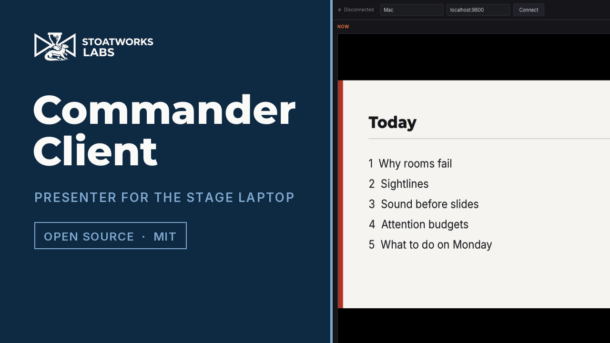
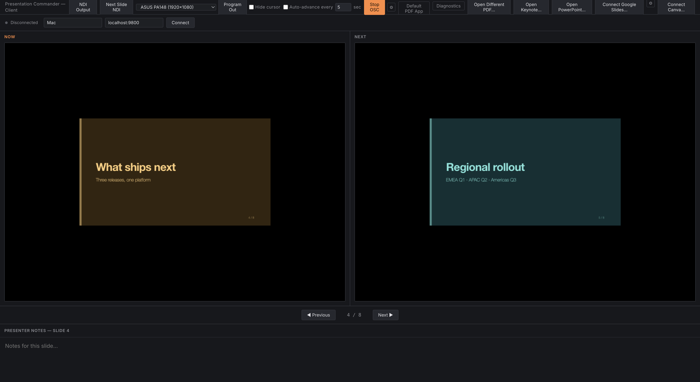
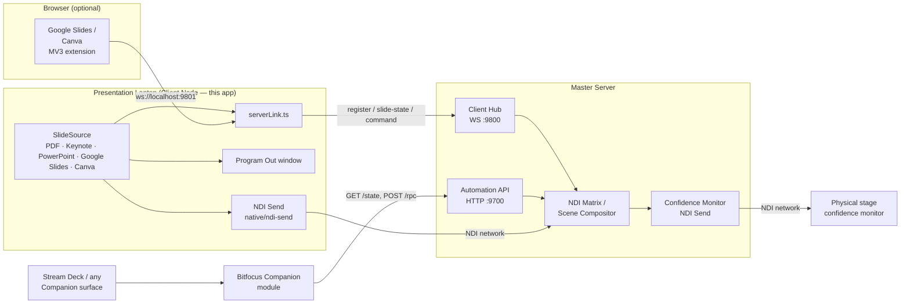

# Presentation Commander — Client

> **AI-assisted project.** This codebase was created with [Claude](https://claude.com/claude-code)
> (Anthropic), directed and reviewed by a human author. That covers the architecture, the
> implementation and the documentation. Check it over before you rely on it for a show.

The app that runs on the presentation laptop, paired with
[presentation-commander-server](https://github.com/stoatworks-labs/presentation-commander-server).
It's a bespoke PDF presentation engine, built as an Electron + React + TypeScript
desktop app, so it doesn't need PowerPoint or Keynote to run a show.

[](https://www.youtube.com/watch?v=J2-2x-FDdw4)

*A 37-second tour. It's the app itself the whole way through, presenting an actual PDF and
driven over its own OSC control surface. It's running standalone here, not paired to a server.*



<!-- downloads:start -->

## Download

**[v1.3.1](https://github.com/stoatworks-labs/presentation-commander-client/releases/tag/v1.3.1)** — prebuilt for macOS, Windows and Linux. Pick your platform:

<details>
<summary><b>macOS</b> — Apple Silicon, Intel</summary>

| Build | Download | Size |
| --- | --- | --- |
| Apple Silicon · .dmg disk image | [`presentation-commander-client-1.3.1-arm64.dmg`](https://github.com/stoatworks-labs/presentation-commander-client/releases/download/v1.3.1/presentation-commander-client-1.3.1-arm64.dmg) | 161 MB |
| Intel · .dmg disk image | [`presentation-commander-client-1.3.1-x64.dmg`](https://github.com/stoatworks-labs/presentation-commander-client/releases/download/v1.3.1/presentation-commander-client-1.3.1-x64.dmg) | 168 MB |
| Apple Silicon · .pkg installer | [`presentation-commander-client-1.3.1-macos-arm64.pkg`](https://github.com/stoatworks-labs/presentation-commander-client/releases/download/v1.3.1/presentation-commander-client-1.3.1-macos-arm64.pkg) | 161 MB |
| Intel · .pkg installer | [`presentation-commander-client-1.3.1-macos-x64.pkg`](https://github.com/stoatworks-labs/presentation-commander-client/releases/download/v1.3.1/presentation-commander-client-1.3.1-macos-x64.pkg) | 168 MB |
| Apple Silicon · .zip archive | [`Presentation.Commander.Client-1.3.1-arm64-mac.zip`](https://github.com/stoatworks-labs/presentation-commander-client/releases/download/v1.3.1/Presentation.Commander.Client-1.3.1-arm64-mac.zip) | 161 MB |
| Intel · .zip archive | [`Presentation.Commander.Client-1.3.1-mac.zip`](https://github.com/stoatworks-labs/presentation-commander-client/releases/download/v1.3.1/Presentation.Commander.Client-1.3.1-mac.zip) | 168 MB |

</details>

<details>
<summary><b>Windows</b> — x64</summary>

| Build | Download | Size |
| --- | --- | --- |
| x64 · .exe installer | [`presentation-commander-client-1.3.1-x64-setup.exe`](https://github.com/stoatworks-labs/presentation-commander-client/releases/download/v1.3.1/presentation-commander-client-1.3.1-x64-setup.exe) | 143 MB |
| x64 · portable .exe | [`presentation-commander-client-1.3.1-x64-portable.exe`](https://github.com/stoatworks-labs/presentation-commander-client/releases/download/v1.3.1/presentation-commander-client-1.3.1-x64-portable.exe) | 143 MB |
| .zip archive | [`Presentation.Commander.Client-1.3.1-win.zip`](https://github.com/stoatworks-labs/presentation-commander-client/releases/download/v1.3.1/Presentation.Commander.Client-1.3.1-win.zip) | 186 MB |

</details>

<details>
<summary><b>Linux</b> — x64</summary>

| Build | Download | Size |
| --- | --- | --- |
| x64 · .deb package (Debian/Ubuntu) | [`presentation-commander-client_1.3.1_amd64.deb`](https://github.com/stoatworks-labs/presentation-commander-client/releases/download/v1.3.1/presentation-commander-client_1.3.1_amd64.deb) | 128 MB |
| x64 · .rpm package (Fedora/RHEL) | [`presentation-commander-client-1.3.1.x86_64.rpm`](https://github.com/stoatworks-labs/presentation-commander-client/releases/download/v1.3.1/presentation-commander-client-1.3.1.x86_64.rpm) | 108 MB |
| x64 · AppImage | [`presentation-commander-client-1.3.1-x86_64.AppImage`](https://github.com/stoatworks-labs/presentation-commander-client/releases/download/v1.3.1/presentation-commander-client-1.3.1-x86_64.AppImage) | 160 MB |

</details>

All builds, checksums and release notes: [github.com/stoatworks-labs/presentation-commander-client/releases](https://github.com/stoatworks-labs/presentation-commander-client/releases).

macOS builds are signed and notarised and open normally. The Windows builds are unsigned, so SmartScreen warns once — see [Windows SmartScreen & Defender Firewall](#windows-smartscreen--defender-firewall) for the one-time click-through.

<!-- downloads:end -->

## What it does

- **Bespoke PDF engine:** open a PDF and you get Now/Next slide previews rendered
  locally with pdf.js. Internal links authored into the PDF (a table of
  contents, "back to agenda" links exported from PowerPoint/Keynote/Google
  Slides) are clickable on the "Now" slide and jump straight to their target
  page. It reads link annotations via pdf.js and resolves each destination to a
  page number, whether it's named or explicit. That's PDF-only, since it's
  exposed as an optional `getLinks` on `SlideSource` that only `pdfSource.ts`
  implements.
- **Keynote integration** (macOS): drives a live, currently-open Keynote
  slideshow directly via AppleScript instead of a pre-exported PDF. Slide
  count and presenter notes are pulled in on open, navigating in the app
  advances the Keynote window itself, and advancing Keynote directly (clicker,
  arrow keys) is polled and reflected back within ~400ms.
- **PowerPoint integration** (macOS and Windows): the same idea as Keynote, with
  the mechanism that suits each platform: AppleScript on macOS, PowerShell COM
  automation (`New-Object -ComObject PowerPoint.Application`) on Windows,
  behind the same `SlideSource` interface either way. Slide count and
  presenter notes are pulled in on open, and navigating in the app drives
  PowerPoint's editing view. On macOS, PowerPoint's AppleScript dictionary has
  no working bulk slide-image export (`save … as PNG/PDF` is declared, but it
  silently does nothing in the version I tested), so frames are captured one
  slide at a time with `copy object` and then read off the system clipboard. On
  Windows, `Slide.Export(path, "PNG", w, h)` does work, so export is a plain
  bulk loop with no clipboard round-trip. Neither platform drives PowerPoint's
  own fullscreen slideshow mode (confirmed unreliable under
  automation/virtualization on both, the same class of problem as Keynote's
  `start`/`show`). The editing view's current slide is enough for everything
  this app needs, since Program Out/NDI is what the audience actually sees.
- **Live capture for Keynote/PowerPoint** (macOS): an alternative to the
  static pre-exported-PNG frames above. It captures the on-screen display
  live via `getDisplayMedia`, so animations, transitions and embedded video
  playback show up in the NDI output, rather than a still of however the
  slide looked at export time. It's opt-in per stream (Program and/or Next
  Slide) via a gear icon next to each NDI toggle, which lists the screens you
  can capture and offers an optional crop region (X/Y/W/H %) for picking out
  part of one, e.g. just the "next slide" box from a captured Presenter
  Display that shows current + next + notes together. Two things needed
  fixing to make this reliable. The video element receiving the stream has to
  be attached to the DOM (a detached one stops receiving frames after a few
  seconds, which is a Chromium resource-management heuristic based on
  visibility, confirmed live). And the window needs `backgroundThrottling: false`
  in `webPreferences`, because Chromium throttles `setInterval` hard enough to
  stall the capture loop within seconds once the window's in the background,
  which is where this app always is in real use (Keynote/PowerPoint is what's
  frontmost while presenting). Fullscreen presentation windows can't be
  enumerated through `desktopCapturer`'s window-level sources on macOS
  (confirmed live: they sit above whatever window level that query reads), so
  this captures a whole physical display rather than one window, matching the
  Program Out display picker's screen-based approach.
- **Canva integration:** connects to a live Canva Presenter Window (opened
  via Present → Presenter view) through the same browser-extension bridge as
  Google Slides. Unlike Slides, Canva has no public API for speaker notes or
  slide state, so both are scraped straight from the Presenter Window's DOM:
  the current slide index from its "N / M" counter, the frame from the
  untainted `<canvas>` it draws slides onto (`canvas.toDataURL()`, no
  `chrome.tabCapture` needed), and the notes text from a `<span>` Canva renders
  once there are notes. The notes `<textarea>` itself only exists as an "Add
  notes…" placeholder prompt when notes are empty, so it can't be read
  directly. Navigating in the app sends synthetic arrow-key events into the
  Presenter Window, the same approach as Google Slides.
- **Presenter notes:** per-slide notes, auto-saved to a `.notes.json`
  sidecar file next to the PDF.
- **Transport:** Previous/Next buttons, a clickable "Next" preview, and
  keyboard navigation (Left/Right, Up/Down, Page Up/Page Down, Space).
- **Program Out:** a second, fullscreen, chrome-free window showing just
  the current slide, for a projector or confidence monitor. Pick which
  connected display it opens on from the dropdown next to the button. Press
  `B`/`W` to blank it to solid black/white without losing your place
  (the same as PowerPoint's presenter shortcuts), and an optional checkbox
  hides the OS cursor over it.
- **NDI Output:** two independent NDI video sources on the network, each with
  its own toggle: **Program Out** (the current slide) and **Next Slide
  NDI** (the upcoming slide, using the same render path as the Now/Next
  preview). So a second receiver, like a stage monitor showing what's coming
  next or a director's preview feed, can pick up the next slide without
  needing the server's composited Confidence Monitor path. It's built directly
  against the official [Vizrt NDI SDK](https://ndi.video/for-developers/ndi-sdk/)
  through a small native N-API addon (`native/ndi-send`), with no third-party
  NDI wrapper. Both run whether or not the Program Out window is open, since
  NDI is a network output rather than a local display.
- **Server link:** connects to the Master Server's client hub over
  WebSocket (`ws://<host>:9800`), registers itself by name, pushes live
  slide/notes state, and takes remote next/previous-slide commands
  from the server's Control Surface.
- **OSC control:** a UDP OSC address space (slide navigation, black/white,
  notes, Program Out open/close, system enable/disable) at
  `/presentcommander/...`, across every source type: PDF, Keynote,
  PowerPoint, Google Slides, Canva. It's plain UDP rather than a Windows COM
  add-in, so it works on every platform this app ships for. A Bitfocus
  Companion module ships alongside it,
  [companion-module-presentation-commander-client](https://github.com/stoatworks-labs/companion-module-presentation-commander-client),
  for driving it from a Stream Deck or any other Companion surface. An
  optional "watched folder" feature, off by default, lets OSC open a
  specific PDF/Keynote/PowerPoint file by filename without a dialog, which is
  handy for a button wall that loads a particular deck on cue. Sections
  (`goto/section`) are mapped from a PDF's own outline/bookmarks, or from
  PowerPoint's native COM `SectionProperties` on Windows. Keynote, Google
  Slides, Canva and PowerPoint on Mac have no native idea of sections to map
  from, so they report none rather than making one up.
  `/presentcommander/slideshow/laserpointer` mirrors the presenter's mouse
  position over the "Now" preview onto Program Out as a glowing dot, like
  PowerPoint's own laser pointer. It works whatever the source, since it's a
  display overlay that has nothing to do with the slide content. Media
  control (`/presentcommander/media/play|pause|playpause|stop` and a
  `media/duration` feedback) only works for PowerPoint on Windows, and only
  when the presenter has a live PowerPoint slideshow running independently
  of this app (started directly in PowerPoint, say). Under the hood it's a
  keyboard-shortcut toggle, because PowerPoint's COM object model has no
  direct play/pause method. It isn't available anywhere else: I went through
  both Keynote's and PowerPoint-for-Mac's scripting dictionaries and neither
  exposes any playback control at all.
  `/presentcommander/slideshow/setwallpaper` renders whatever's on screen
  and sets it as the desktop wallpaper on every connected monitor. It works
  for every source type, through the same `renderFrame` every SlideSource
  already implements. macOS and Windows are fully covered, and Linux is
  GNOME-only. **Timed auto-advance** is an optional "advance every N seconds"
  mode (it stops at the last slide rather than looping), with its own
  play/pause control next to the OSC settings.
  `/presentcommander/slideshow/pause` and `/resume` suspend and resume it
  remotely once it's on, and do nothing if it was never enabled.
- **Set as Default PDF App:** a titlebar button that makes double-clicking
  a PDF open it straight into this app. PDF is the one source type here with
  a proper cross-platform "default app" concept, and Keynote/PowerPoint files
  already have their own native defaults that this doesn't presume to
  override. What it does differs by OS, since neither Windows nor macOS lets
  a third-party app grab the default-app slot without asking: on Windows it
  registers the app as a candidate and then opens Settings for you to confirm;
  on macOS it registers with Launch Services and sets the default directly
  if `duti` is installed (`brew install duti`), and otherwise shows you the
  manual steps; on Linux it's fully automatic via `xdg-mime`. The status
  message always says what actually happened, and never claims "done" when
  the answer is "you still need to confirm it".

## Architecture



### Building from source

The native send addon links against the NDI SDK at build time. Install
the [NDI SDK](https://ndi.video/for-developers/ndi-sdk/) first (macOS
default: `/Library/NDI SDK for Apple`; set `NDI_SDK_DIR` if yours lives
somewhere else). `npm install` rebuilds the addon automatically via
`@electron/rebuild`.

### Google Slides / Canva bridge (optional)

`extension/` is one unpacked Chrome extension that lets the Client connect
to a live Google Slides Presenter View or a live Canva Presenter Window
instead of a local PDF/Keynote file. Load it via `chrome://extensions` →
Developer mode → Load unpacked. Both platforms relay through the same local
WebSocket bridge (`ws://localhost:9801`), and an `app` field on every message
tells the Client which `SlideSource` it belongs to. Fetching Google Slides
speaker notes needs a one-time OAuth client registration in Google Cloud
Console. Click the ⚙ next to "Connect Google Slides…" in the app for
step-by-step instructions and a field to paste the client ID straight into
`extension/manifest.json`. There's no file editing by hand, but you do still
have to reload the extension once at `chrome://extensions` afterwards,
because Chrome only picks up manifest changes on reload. The full
walkthrough is also written out at
[`extension/OAUTH_SETUP.md`](extension/OAUTH_SETUP.md). Canva needs no
OAuth setup, as its notes and slide state are scraped from the Presenter
Window's DOM rather than fetched from an API.

A note on MV3 service worker reliability: the extension's background
service worker calls `connect()` defensively on every incoming message
rather than relying only on its `setTimeout`-based reconnect loop. Chrome
throws away pending timers when it suspends an idle service worker, so a
`setTimeout` reconnect scheduled just before suspension would otherwise
never fire.

## Status

Feature-complete for its current scope: the bespoke PDF engine, the Keynote
(macOS), PowerPoint (macOS and Windows), Google Slides and Canva sources,
dual NDI outputs (Program + Next Slide), live capture for Keynote/PowerPoint,
presenter notes, the Program Out window, and the Master Server link / Control
Surface integration are all built and verified. Keynote drive and live
capture are macOS-only (there's no Windows equivalent for either yet); PDF,
Google Slides and Canva work on both platforms.

## Documentation

| Doc | Contents |
|---|---|
| [docs/USER-GUIDE.md](docs/USER-GUIDE.md) | Running a show: choosing a source, Program Out, NDI, live capture, remote control, troubleshooting |
| [docs/API.md](docs/API.md) | The full OSC address space (actions + feedback), the server link, the extension bridge, and the `.notes.json` sidecar format |
| [docs/DEVELOPING.md](docs/DEVELOPING.md) | Setup, the NDI SDK build dependency, adding a `SlideSource`, and the traps |

## Inspiration & prior art

This app's OSC control, its PowerPoint media-control research and its
wallpaper-export feature were all shaped by looking at how existing
remote-PowerPoint-control tools work. Here's what I did and didn't take from
each:

- **[OSCPoint](https://github.com/phuvf/oscpoint):** a Windows PowerPoint
  add-in with an OSC API. It's closed-source, so I didn't copy anything from
  it. I read its public documentation (`ACTIONS.md`/`FEEDBACKS.md`/`EVENTS.md`/
  `PRESENTATION.md`) to design a comparable address space and the two-port
  (action-in/feedback-out) architecture this app uses. That address space
  started out mirroring OSCPoint's own (`/oscpoint/...`, matching ports) so
  it'd drop straight into Companion. It's since been renamed to
  `/presentcommander/...` and cut loose from OSCPoint entirely, now that this
  app has its own Companion module.
- **[benkuper/PowerPoint-OSC](https://github.com/benkuper/PowerPoint-OSC)**
  and **[leonreucher/powerpoint-remote-websocket](https://github.com/leonreucher/powerpoint-remote-websocket):**
  two public, open-source VSTO (C#/.NET) PowerPoint add-ins. I read their
  source to answer one question during this app's PowerPoint media-control
  work: is external COM automation of PowerPoint's slideshow/media viable at
  all? Both confirmed that `SlideShowSettings.Run()` is a normal, working COM
  call in practice, and that neither add-in ever calls a direct Play()/Pause()
  method on a media shape (they only detect and count them). That's what led
  to this app's own Alt+P `SendKeys` toggle in `powerpointBridgeWin.ts`
  instead of a (nonexistent) direct COM method. No C#/VSTO code was ported:
  both add-ins run in-process inside PowerPoint, while this app automates
  PowerPoint from outside via PowerShell COM calls. The architectures are
  different enough that reuse wasn't really possible, only the facts about
  what PowerPoint's COM model does and doesn't expose.
- **[Iris Down Remote Show Control](https://irisdown.co.uk/rsc.html):** an
  older, separate commercial PowerPoint add-in that takes plain ASCII text
  commands (`NEXT`, `PREV`, `GO`, `RUNCURRENT`, `SETBG`, …) over UDP/TCP,
  with no feedback channel at all. Its command set overlaps in concept with
  several features here: slide navigation, starting from the current slide,
  and in particular `SETBG`'s "set desktop wallpaper to the current slide",
  which this app's wallpaper export also does. Nothing was read from its
  source (it isn't public) or its wire format (plain text vs. this app's
  OSC). They overlap in features, not in implementation.

## Project Setup

### Install

```bash
npm install
```

### Development

```bash
npm run dev
```

### Build

```bash
# Windows
npm run build:win

# macOS
npm run build:mac

# Linux
npm run build:linux
```

## Windows SmartScreen & Defender Firewall

macOS builds are **Developer ID-signed and notarised by Apple**, so they open
normally, with no Gatekeeper warning and no quarantine step. The Windows
binaries **aren't** code-signed, so Windows still warns you the first time.

- **Windows:** SmartScreen shows *"Windows protected your PC"* →
  **More info** → **Run anyway**.
- **Windows Defender Firewall:** the first launch pops up *"Allow Presentation Commander
  Client to communicate on these networks"*. Tick **Private** (and **Domain** on a
  managed network). Presentation Commander Client needs it to take control from the
  Master Server and send its Program and Next-Slide NDI outputs. Deny it and the Server
  won't discover it, and no NDI outputs will appear downstream.
- **Linux:** no signing gate.

Per-artifact steps, self-signing, checksum verification and the Defender Firewall reset
procedure: **[docs/UNSIGNED.md](docs/UNSIGNED.md)**.

## Recommended IDE Setup

- [VSCode](https://code.visualstudio.com/) + [ESLint](https://marketplace.visualstudio.com/items?itemName=dbaeumer.vscode-eslint) + [Prettier](https://marketplace.visualstudio.com/items?itemName=esbenp.prettier-vscode)

## Trademarks and third-party licences

**NDI® is a registered trademark of Vizrt NDI AB.** See <https://ndi.video>.
This project is not affiliated with or endorsed by Vizrt.

The NDI runtime is obtained separately under Vizrt's own terms and is not
redistributed here. NDI Tools are not redistributed either — get them from
<https://ndi.video/tools>.

H.264, H.265 and AAC are separately licensable formats. The NDI SDK grant does
not cover them, and the obligation sits with whoever ships a product using them.

<!-- attributions:start -->
This project is built on other people's work — see [ATTRIBUTIONS.md](ATTRIBUTIONS.md).
<!-- attributions:end -->
